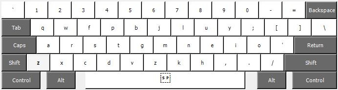

# Colemak-DH for Windows

Installs Colemak-DH (US ANSI, angle mod) as a native Windows keyboard layout. The installer and `.klc` source here are copied unmodified from the [Mod-DH project's klc folder](https://github.com/ColemakMods/mod-dh/tree/master/klc). Nothing runs in the background afterward; it's a regular layout DLL registered with Windows, so it works at the login screen, in games, and in remote desktop sessions.

## Install

1. Download `colemak_dh_ansi_us.zip` from this folder and extract it.
2. Open the extracted `cdh_us` folder and run `setup.exe`. Accept the UAC prompt. The installer picks the right architecture (`amd64` on every modern PC) and registers the layout as **Colemak-DH (US)** under English (United States).
3. Open **Settings > Time & Language > Language & region**, click the **…** next to **English (United States)**, then **Language options**.
4. Under **Keyboards**, click **Add a keyboard** and pick **Colemak-DH (US)**.
5. Optional but recommended: remove **US** (QWERTY) from the same list so Windows never silently switches you back. Keep it if other people use the machine.
6. Sign out and back in so the layout is also active at the lock screen and in apps that were already open.

## Switching layouts

If more than one keyboard is installed, `Win + Space` cycles between them and `Left Alt + Shift` toggles. To turn that toggle off (it's easy to hit by accident), go to **Settings > Time & Language > Typing > Advanced keyboard settings > Input language hot keys** and change the "Between input languages" key sequence to **Not Assigned**.

## Set it as the default for every user

The step above only changes the current account. To make it the default for new accounts, the welcome screen, and the system account:

1. Open the old Control Panel: `Win + R`, type `control`, Enter.
2. **Clock and Region > Region > Administrative** tab > **Copy settings…**.
3. Tick **Welcome screen and system accounts** and **New user accounts**, then OK.

## Verify

Open Notepad and type the home row left to right. It should read `arstgmneio`. The bottom row from the physical `Z` key should read `xcdvzkh,./`, which confirms the angle mod is in.

## Uninstall

**Settings > Apps > Installed apps**, find **Colemak-DH (US)** and uninstall it. Remove it from the keyboard list in Language options first if Windows complains it's in use.

## Customizing

The source is `colemak_dh_ansi_us.klc`. Open it in [Microsoft Keyboard Layout Creator](https://www.microsoft.com/en-us/download/details.aspx?id=102134) (MSKLC 1.4, still the tool to use), edit, then **Project > Build DLL and Setup Package** to produce a new installer. MSKLC needs .NET Framework 3.5, which Windows will offer to enable the first time it's launched. Uninstall the old layout before installing a rebuilt one with the same name.

## Alternatives, if the installer isn't an option

- **AutoHotkey script**: no admin needed, remaps at the application level. Download `colemak_dh_ansi.ahk` from the [Mod-DH autohotkey folder](https://github.com/ColemakMods/mod-dh/tree/master/autohotkey) and run it with AutoHotkey v1. It won't affect the login screen or elevated windows.
- **Kanata**: cross-platform remapper, also with a config in the Mod-DH repo. Useful if you want home-row mods at the OS level rather than in firmware.
